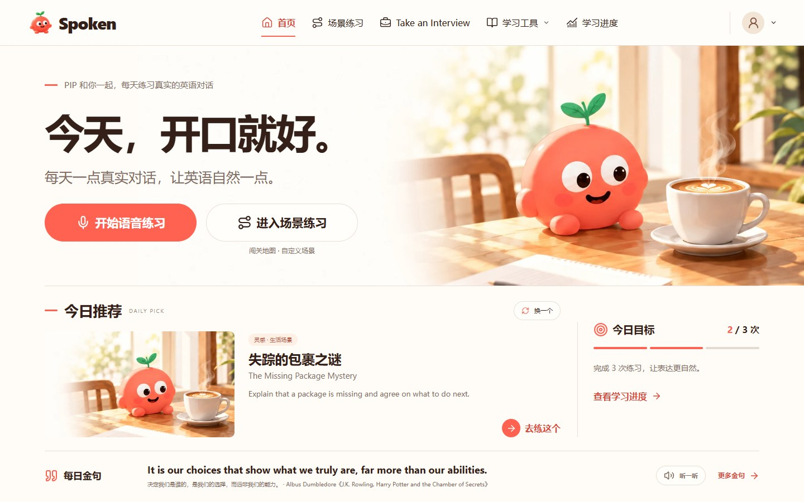
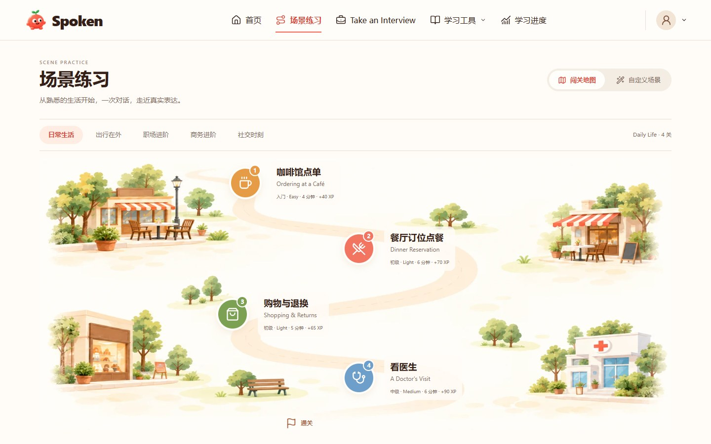
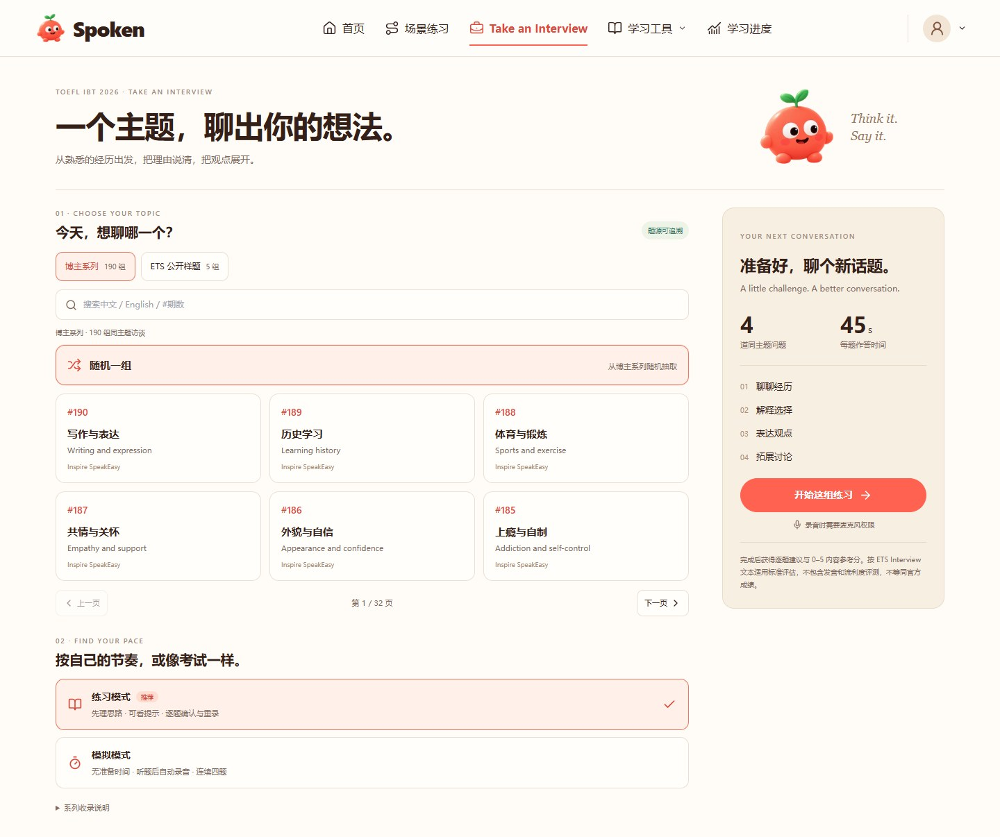
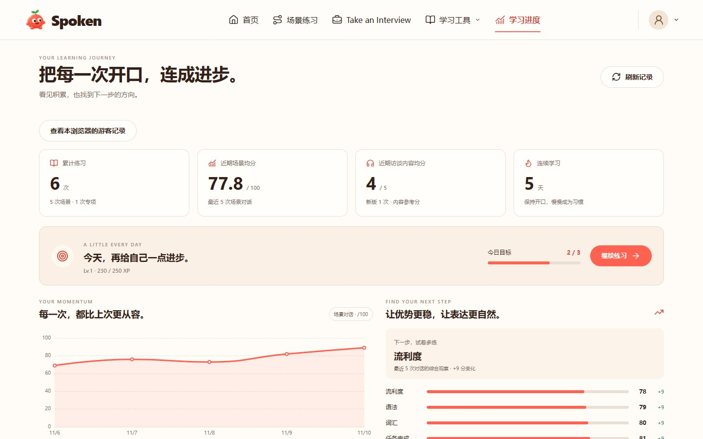

# Spoken · Practice English with Pip

Spoken is an AI English speaking coach for Chinese learners. Practice everyday conversations, build a custom role-play, or try **Take an Interview** for the current TOEFL speaking format. Both text and voice are available.

[](https://github.com/EthanLyu30/spoken/actions/workflows/ci.yml) · [Live demo](https://www.spokenai.org/) · [中文](README.md) · [Roadmap](docs/ROADMAP.md)

## What you can practice

| Area | How it works |
| --- | --- |
| Home | Start from the daily recommendation, refresh it for a new idea, and see the daily goal and quote |
| Scenario practice | Pick a chapter and stop on the journey map, or describe a custom role-play in one sentence |
| Conversation | Talk or type with Pip and get streaming replies. Open corrections, the dictionary, or pronunciation practice when needed. Print the session debrief or save it as a PDF |
| Take an Interview | Choose practice or simulation. Answer four questions on one topic with 45 seconds per question. The results include a 0–5 practice score for answer content, feedback, and written samples. Older records retain their original six-point scale |
| Learning tools | Browse daily quotes and save words, phrases, and sentences for spaced review |
| Progress | Review history, goals, and trends. Sign up from your profile to keep saved guest progress and continue on another device |

Replies use the browser's device voice by default. iFlytek handles speech recognition and pronunciation scoring. Moonshine and Kokoro are optional local models. Incomplete recognition stays editable for confirmation. Records retained under a guest identity can be opened from Learning Progress on the same browser.

Signed-in learners can export their data or confirm account deletion with their password under **My Spoken → Account and data**. Email verification and password reset require a configured mail sender.

## Current interface

| Home and daily recommendation | Scenario journey map |
| --- | --- |
|  |  |
| **Take an Interview** | **Learning progress** |
|  |  |

Desktop browser captures use the current app with synthetic local practice data. The gallery also includes conversation, custom scenes, daily quotes, and vocabulary. [Screenshot gallery](docs/screenshots/README.md)

## Architecture

Streaming chat and read-aloud form the interactive path. Corrections, pronunciation scoring, and debriefs run when requested using the transcript and structured scoring data.

- React, TypeScript, Vite, Tailwind CSS, Zustand, and ECharts on the frontend.
- Python, FastAPI, and SQLAlchemy on the backend, with SQLite locally and PostgreSQL in production.
- DeepSeek for conversation and text feedback, iFlytek IAT / ISE for recognition and pronunciation scoring, and device speech for read-aloud. [Architecture](docs/ARCHITECTURE.md) · [Deployment](docs/DEPLOY.md)

## Quick start

Use Python 3.11+ and Node.js 20+. Start the backend first. These commands are for macOS and Linux.

```bash
cd backend
python -m venv .venv
cp .env.example .env
.venv/bin/python -m pip install -r requirements.txt
.venv/bin/python -m uvicorn app.main:app --reload
```

On Windows, use `Copy-Item .env.example .env` and `.\.venv\Scripts\python.exe`. Fill in `DEEPSEEK_API_KEY` in `backend/.env` before using AI conversation and scoring. Add the `XF_*` credentials for recognition and pronunciation assessment.

Start the frontend in a separate terminal from the repository root.

```bash
cd frontend
npm ci
npm run dev
```

Open <http://localhost:5173>. The API docs are at <http://127.0.0.1:8000/docs>. Production uses a stable `JWT_SECRET` and a PostgreSQL `DATABASE_URL`. Use `GUEST_CLAIM_PROTOCOL` to control the guest rollout and rollback. [Deployment configuration](docs/DEPLOY.md) · [Guest claim verification](docs/performance/2026-11-10-shadow-claim-protocol.md)

The original demo shows an earlier UI. [Short demo](docs/demo.mp4) · [Full walkthrough on Bilibili](https://www.bilibili.com/video/BV1yZEW6xEta/)

[MIT License](LICENSE)
