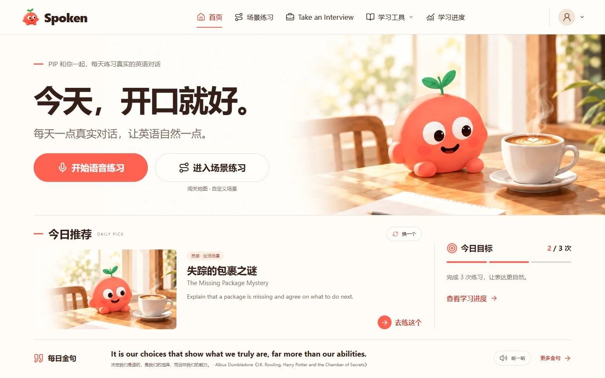
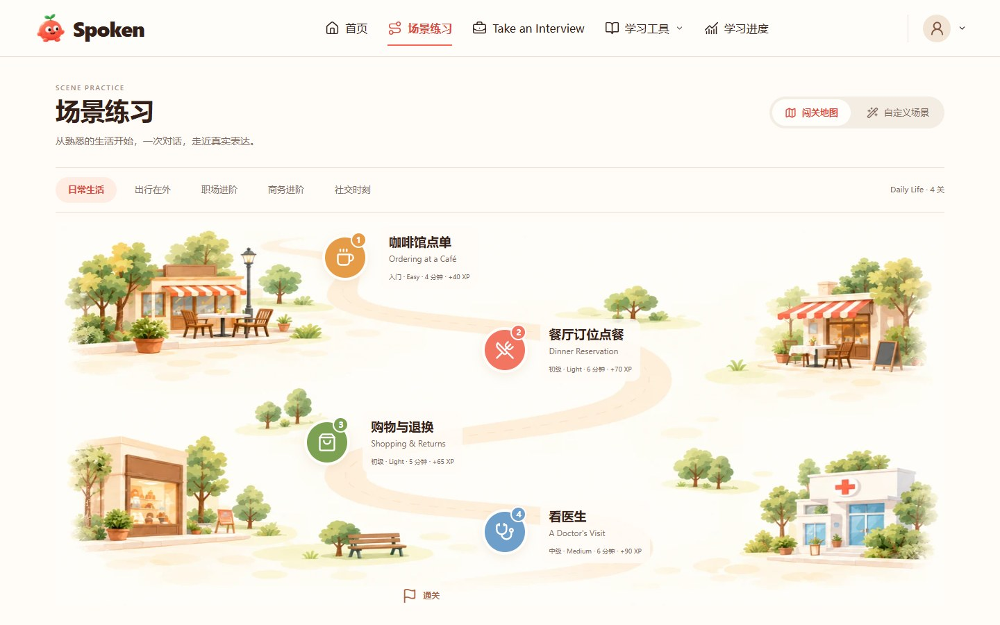
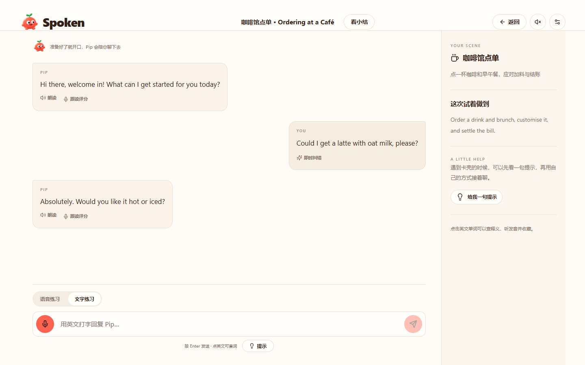
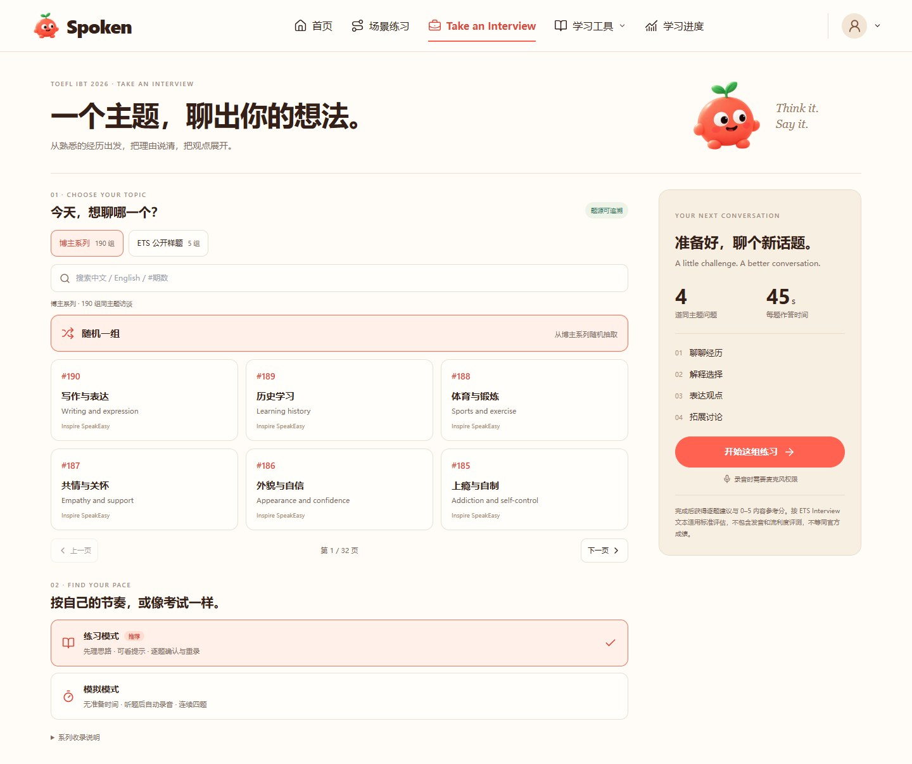
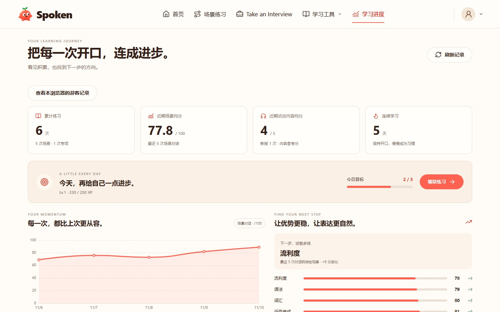
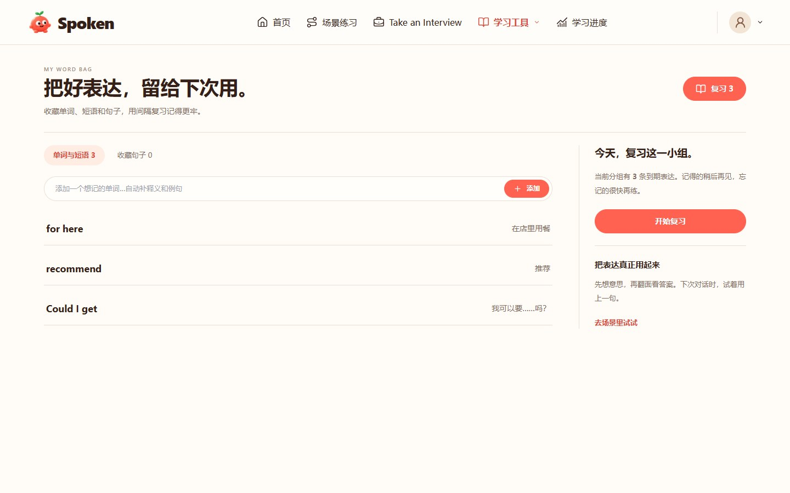

# Spoken · 和 Pip 一起练英语口语

Spoken 是面向中文学习者的 AI 英语口语陪练。在咖啡馆点单、和同事讨论工作，或用 **Take an Interview** 练习新托福口语。可以开麦对话，也可以打字练习。

[](https://github.com/EthanLyu30/spoken/actions/workflows/ci.yml) · [在线体验](https://www.spokenai.org/) · [English](README.en.md) · [开发路线图](docs/ROADMAP.md)

## 可以练什么

| 模块 | 用法 |
| --- | --- |
| 首页 | 从「今日推荐」直接开练，点「换一个」刷新推荐，也可以查看今日目标和每日金句 |
| 场景练习 | 在闯关地图里按章节选场景，或用一句话创建自己的角色扮演 |
| 场景对话 | 与 Pip 进行流式文字或语音对话，按需查看即时纠错、词典和跟读评分。结束后可生成小结，并打印或保存为 PDF |
| Take an Interview | 默认练习模式，另有模拟模式。同一主题四题，每题 45 秒。答完后查看单题 0–5 分的内容参考分、反馈与文字参考答案。旧历史保留原来的 `/6` 分制 |
| 学习工具 | 阅读每日金句，收藏单词、短语和句子，使用间隔复习 |
| 学习进度 | 查看练习历史、每日目标和成长趋势。可在「我的」注册账号，同步本浏览器已保存的游客进度，在其他设备登录续练 |

对话回复默认使用浏览器提供的设备语音朗读。讯飞提供录音识别和发音评测。本地 Moonshine / Kokoro 可在语音设置中选用。识别不完整时，可先编辑并确认转写。已保留在游客身份下的记录，可以在「学习进度 → 查看本浏览器的游客记录」查看。

登录后可在「我的 → 账号与数据」导出学习数据，或用当前密码确认删除账号。邮箱验证和密码重置需要部署方配置发信服务。

## 当前界面

| 首页 · 今日推荐 | 场景练习 · 闯关地图 |
| --- | --- |
|  |  |
| **场景对话 · 咖啡馆** | **Take an Interview · 练习与模拟** |
|  |  |
| **学习进度 · 历史与趋势** | **生词本 · 收藏与复习** |
|  |  |

截图来自当前代码的桌面浏览器实拍，练习记录和对话为本地演示数据。每日金句和自定义场景也有截图。 [截图索引](docs/screenshots/README.md)

## 技术架构

对话流式生成和朗读走快路。发音评测、纠错与课后小结按需运行，使用转写和音素等结构化数据。

```text
麦克风 → 浏览器 VAD → 流式 ASR → 对话模型 → 设备语音 / 本地朗读
                         └→ 转写 → 即时纠错、课后小结与训练记录
录音评测 → 讯飞 ISE → 词级与音素级反馈
```

- 前端使用 React、TypeScript、Vite、Tailwind CSS、Zustand 和 ECharts。
- 后端使用 Python、FastAPI 和 SQLAlchemy，本地可用 SQLite，生产支持 PostgreSQL。
- DeepSeek 提供对话和文本反馈。讯飞 IAT / ISE 提供语音识别与发音评分。
- 管理员可在私有运行看板查看请求、浏览器体验、错误诊断及成本参考。 [架构说明](docs/ARCHITECTURE.md) · [部署指南](docs/DEPLOY.md)

## 本地运行

需要 Python 3.11+ 和 Node.js 20+。先启动后端，在 Windows PowerShell 中运行以下命令。

```powershell
cd backend
python -m venv .venv
Copy-Item .env.example .env
.\.venv\Scripts\python.exe -m pip install -r requirements.txt
.\.venv\Scripts\python.exe -m uvicorn app.main:app --reload
```

macOS / Linux 可用 `cp .env.example .env`，并将上述 Python 路径换成 `.venv/bin/python`。需要 AI 对话和评分时，在启动前填写 `backend/.env` 中的 `DEEPSEEK_API_KEY`。需要录音识别和发音评分时，再填写 `XF_APP_ID`、`XF_API_KEY` 和 `XF_API_SECRET`。

在仓库根目录另开一个终端启动前端。

```bash
cd frontend
npm ci
npm run dev
```

前端默认在 <http://localhost:5173>，API 文档在 <http://127.0.0.1:8000/docs>。也可从仓库根目录运行 `docker compose up --build`，启动前先准备好 `backend/.env`。

生产部署使用稳定的 `JWT_SECRET` 和 PostgreSQL `DATABASE_URL`。可用 `GUEST_CLAIM_PROTOCOL` 控制游客认领和回滚。 [部署配置](docs/DEPLOY.md) · [认领验收](docs/performance/2026-11-10-shadow-claim-protocol.md)

## 项目资料

- [当前待办与交付历史](docs/ROADMAP.md)
- [语音可靠性](docs/VOICE_RELIABILITY.md)
- 早期演示记录了旧界面。 [仓库短版视频](docs/demo.mp4) · [Bilibili 完整讲解](https://www.bilibili.com/video/BV1yZEW6xEta/)

[MIT 许可证](LICENSE)
